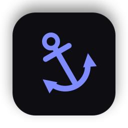
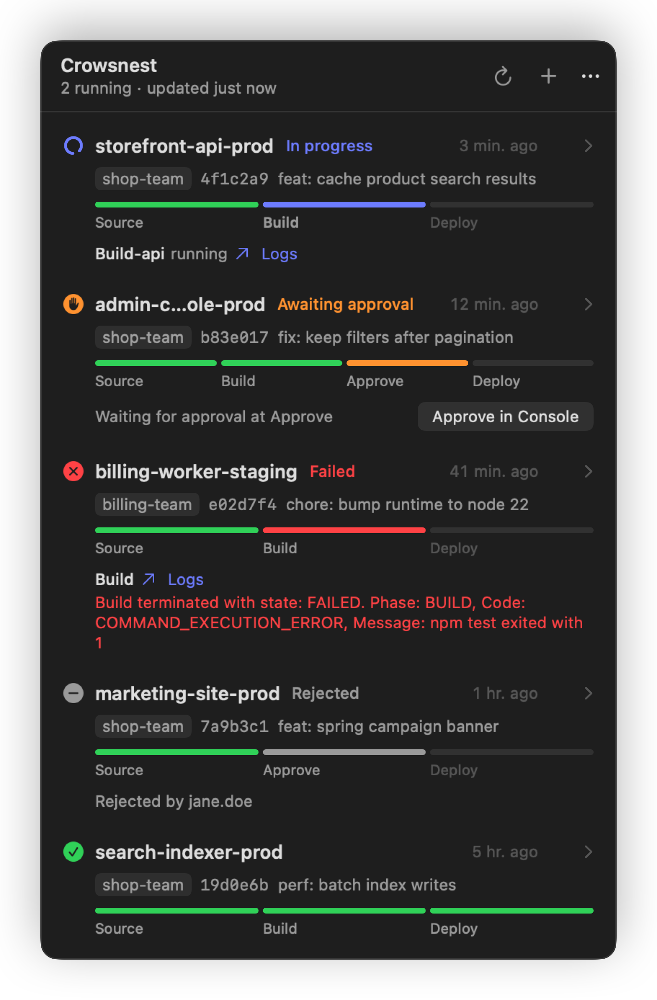
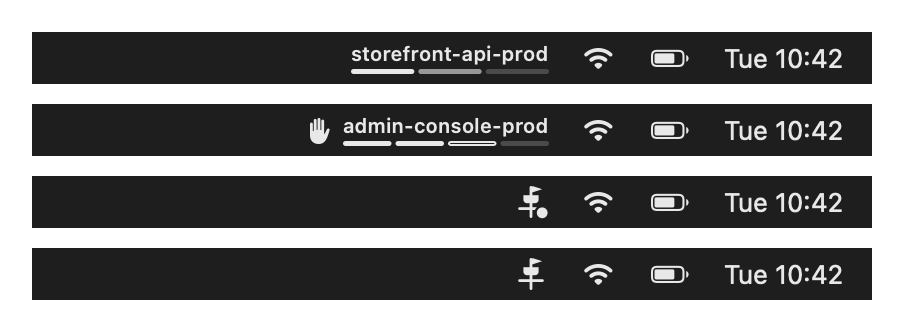
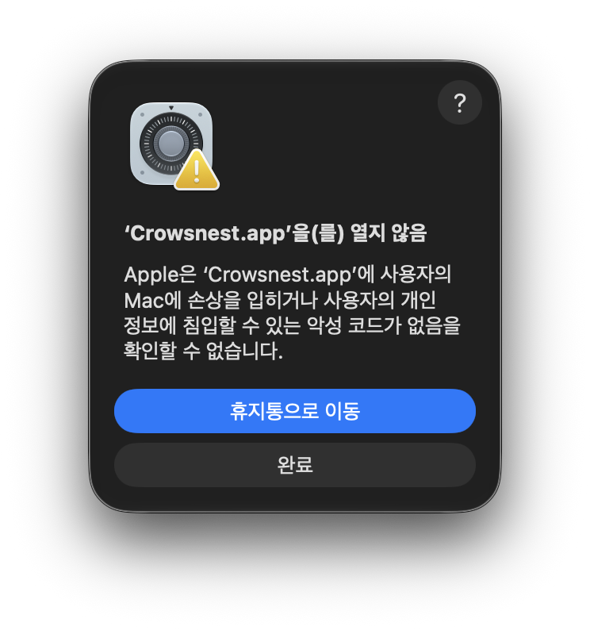
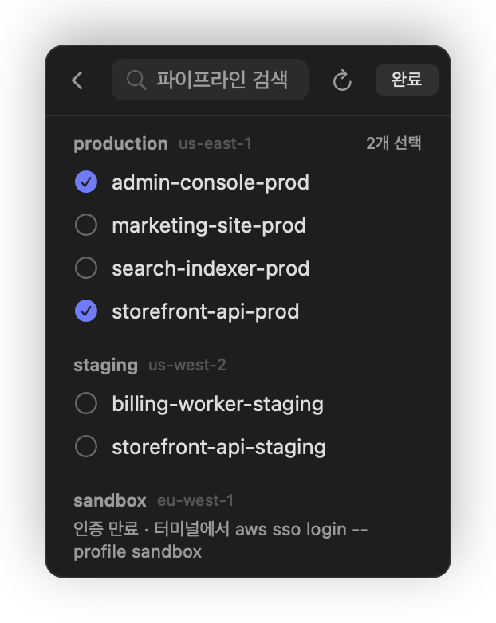
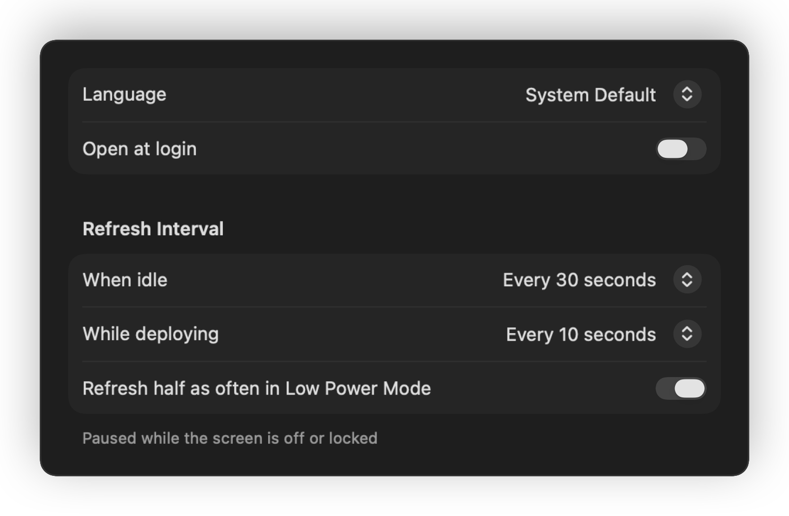
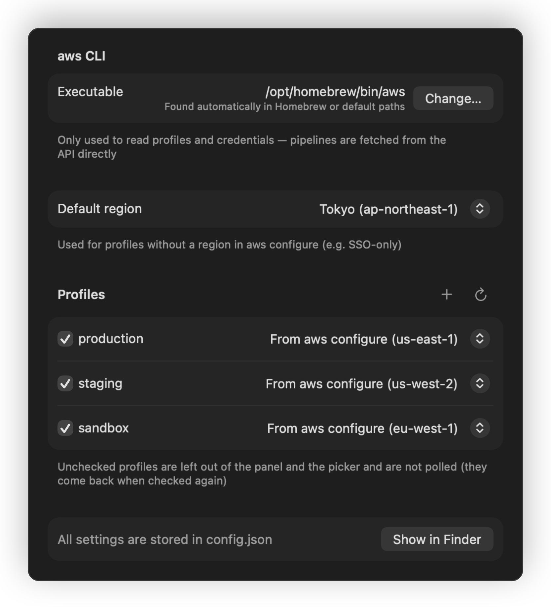
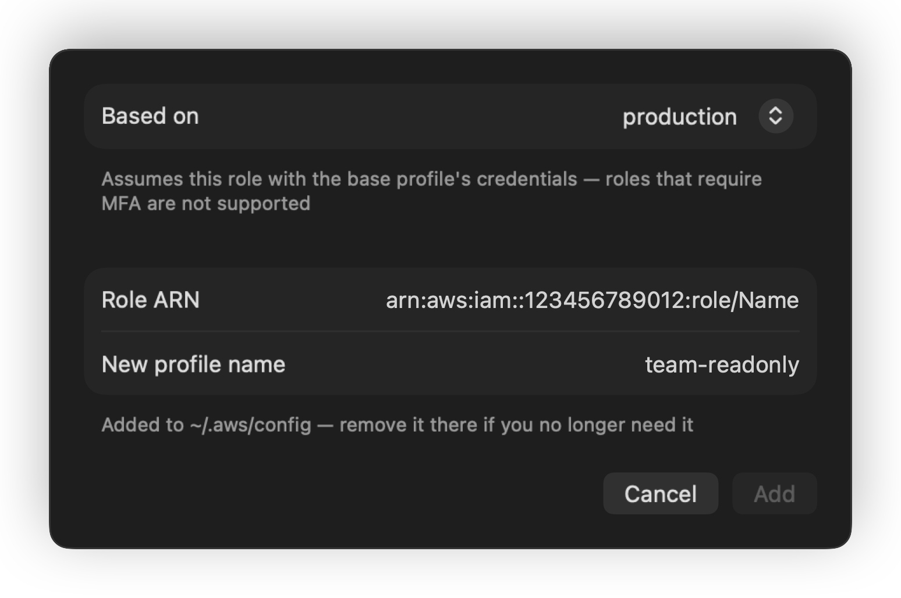

<p align="center">
  
</p>

<h1 align="center">Crowsnest</h1>

<p align="center">Watch your AWS CodePipeline deployments from the macOS menu bar.</p>

<p align="center"><b>English</b> · <a href="README.ko.md">한국어</a></p>

<p align="center">
  <picture>
    <source media="(prefers-color-scheme: light)" srcset="docs/images/panel-light.png">
    
  </picture>
</p>

## Features

- **Menu bar at a glance** — while a deployment runs, the menu bar shows the pipeline name with one bar per stage. When nothing is running it is just an icon.
- **Notifications that mean something** — you get notified when a deployment finishes (succeeded or failed) and when it starts waiting for a manual approval. An approval someone rejected on purpose is shown as **rejected**, not as a failure.
- **Why it failed, right there** — the failing action's error message and a link to its build log, without opening the console.
- **Zero setup** — uses the AWS profiles and SSO sessions already on your Mac. Profiles and pipelines are discovered automatically; nothing is hard-coded.
- **Light on battery** — polling calls the CodePipeline API directly instead of spawning `aws` processes, pauses while the screen is off or locked, slows down in Low Power Mode, and stops animations while the panel is closed.

<p align="center">
  <picture>
    <source media="(prefers-color-scheme: light)" srcset="docs/images/menubar-light.png">
    
  </picture>
</p>

| Menu bar | Meaning |
| --- | --- |
| Name + bars | A deployment is running. Solid bars are finished stages, the mid-tone bar is running, faint bars are still to come. |
| Hand + name + hollow bar | Waiting for a manual approval. |
| Icon with a dot | Something failed, or a pipeline could not be read (for example an expired SSO session). Open the panel for details. |
| Icon only | All quiet. |

## Requirements

- macOS 14 or later (Apple silicon)
- [AWS CLI v2](https://docs.aws.amazon.com/cli/latest/userguide/getting-started-install.html) 2.9 or later — `brew install awscli`
- At least one profile set up with `aws configure` or `aws configure sso`
- Read-only permissions: `codepipeline:ListPipelines`, `codepipeline:GetPipelineState`, `codepipeline:ListPipelineExecutions`

## Install

### From a release

1. Download `Crowsnest-<version>.dmg` from [Releases](https://github.com/ldhbenecia/crowsnest/releases), open it and drag **Crowsnest** onto **Applications**.
2. Run this once in Terminal:

   ```bash
   xattr -dr com.apple.quarantine /Applications/Crowsnest.app
   ```

3. Open **Crowsnest** from Applications. The anchor icon appears in the menu bar.

#### Why the command?

Crowsnest is ad-hoc signed but not notarized, because there is no paid Apple Developer account behind it. Without step 2, the first launch is blocked with this warning:

<p align="center">
  
</p>

It means Apple has not scanned the app, not that anything was found. Click **Done** (not **Move to Trash**), run the command from step 2 and open the app again. Instead of the command you can also go to **System Settings → Privacy & Security** and click **Open Anyway** — on macOS 15 and later, right-click → Open no longer skips the warning.

A newly downloaded version is blocked the same way, so repeat step 2 after each update.

### From source

Only the Xcode Command Line Tools are needed.

```bash
git clone https://github.com/ldhbenecia/crowsnest.git
cd crowsnest
./script/build_and_run.sh --install
```

## Usage

1. Click the anchor icon in the menu bar, then **Choose Pipelines** or the `+` button.
2. Pipelines are grouped by profile. Search and tick the ones you want to watch.
3. Click a row to expand every stage and action. Hover a row to reveal a button that opens it in the AWS console.
4. Drag rows to reorder them, or right-click a row for **Move to Top**. When several deployments run at once, the menu bar shows the highest one.
5. Right-click (or Control-click) the menu bar icon for **About Crowsnest** and **Quit**. Settings live in the panel's `···` menu.

<p align="center">
  
</p>

The interface is available in English and Korean (한국어). It follows your macOS language by default and can be changed in **Settings → General → Language**.

## Settings

Open **Settings** from the `···` menu in the panel header, or press ⌘, while the panel is open. Changes apply immediately.

<p align="center">
  
</p>

<p align="center">
  
</p>

- **General** — language, open at login, refresh interval while idle and while a deployment runs, slow down in Low Power Mode.
- **Notifications** — turn notifications on or off per event (succeeded, failed or stopped, approval needed, rejected) and toggle the sound.
- **AWS** — the `aws` executable in use, default region, and for every profile whether to show it and which region to use.

### Multiple roles

If you switch between several roles, add one profile per role with **+** next to **Profiles**. Every profile is polled at the same time, so all roles show up in one panel. Pick an existing profile to base it on:

- **SSO role** — reuses the base profile's SSO sign-in and only changes the account ID and role name. One `aws sso login` covers all of them.
- **Assume role** — assumes a `role_arn` with the base profile's credentials (`source_profile`). Roles that require MFA are not supported.

The profile is written to `~/.aws/config` with `aws configure set`. To remove it, delete its section from that file.

<p align="center">
  
</p>

Everything is stored in `~/.config/crowsnest/config.json`, so you can also keep it in your dotfiles. Edits made to the file directly are picked up on the next launch.

| Key | Default | Description |
| --- | --- | --- |
| `defaultRegion` | `"ap-northeast-1"` | Region for profiles that have none in `aws configure` (e.g. SSO-only profiles). |
| `regionOverrides` | `{}` | Region per profile, e.g. `{"staging": "us-west-2"}`. Pipelines you already picked follow the new region. |
| `hiddenProfiles` | `[]` | Profiles to leave out. Their pipelines disappear from the panel and are not polled until shown again. |
| `awsCLIPath` | — | Path to the `aws` executable. When empty, `/opt/homebrew/bin`, `/usr/local/bin` and `/usr/bin` are searched. |
| `pollIntervalSeconds` | `30` | Refresh interval when nothing is running. |
| `activePollIntervalSeconds` | `10` | Refresh interval while a deployment is running. |
| `slowDownInLowPowerMode` | `true` | Double both intervals in Low Power Mode. |
| `notificationsEnabled` | `true` | Master switch for notifications. |
| `notifyOnSuccess` · `notifyOnFailure` · `notifyOnApprovalRequest` · `notifyOnRejection` | `true` | Per-event notifications. |
| `notificationSound` | `true` | Play a sound with notifications. |
| `language` | `"system"` | `"system"`, `"en"` or `"ko"`. |

If every pipeline fails to load (offline, expired session), Crowsnest retries every 5 minutes until you press refresh.

## Troubleshooting

**"Session expired · run aws sso login --profile …"**
Run the suggested `aws sso login` command, then press refresh (↻) in the panel. Without refresh it retries within 5 minutes.

**"aws CLI not found"**
Install it with `brew install awscli`, or enter the output of `which aws` in **Settings → AWS**.

**A profile shows no pipelines**
Usually the region is wrong. Check `aws configure get region --profile <profile>` and set the profile's region in **Settings → AWS** if needed.

**The menu bar icon is missing**
On Macs with a notch, menu bar items that do not fit are hidden. Remove some items, or ⌘-drag icons to reorder them.

**No notifications**
Check System Settings → Notifications → Crowsnest. Permission is requested on first launch.

**Logs**

```bash
log stream --info --predicate 'subsystem == "com.ldhbenecia.crowsnest"'
```

## Development

```bash
swift build                    # build
./script/test.sh               # tests (passes swift-testing paths when only Command Line Tools are installed)
./script/build_and_run.sh      # assemble the .app and launch it (--logs, --verify, --install)
./script/make_icon.sh          # redraw the app icon and the DMG window background
./script/screenshots.sh        # regenerate the images in docs/images from sample data
```

### Releasing

The version lives in the `VERSION` file. The build writes it into `Info.plist` together with the commit hash and build date, which the About window shows.

```bash
echo 0.2.0 > VERSION && git commit -am "chore: 0.2.0"
git tag v0.2.0 && git push origin main v0.2.0
```

Pushing a `v*` tag runs the [Release workflow](.github/workflows/release.yml): it checks the tag matches `VERSION`, runs the tests, builds `Crowsnest-0.2.0.dmg` and publishes a GitHub Release with the DMG and `Crowsnest-0.2.0.dmg.sha256`.

Release notes are generated from the conventional commits since the previous tag (`feat` → Features, `fix` → Fixes, `perf` → Performance, `refactor` → Changes; `chore`, `ci`, `docs`, `test` and `build` are left out). Preview them before tagging with `./script/release_notes.sh HEAD`. Every push and pull request also runs [CI](.github/workflows/ci.yml) (build and tests).

To build the DMG locally instead, run `./script/package.sh`. Builds are ad-hoc signed and not notarized.

## License

[MIT](LICENSE)
